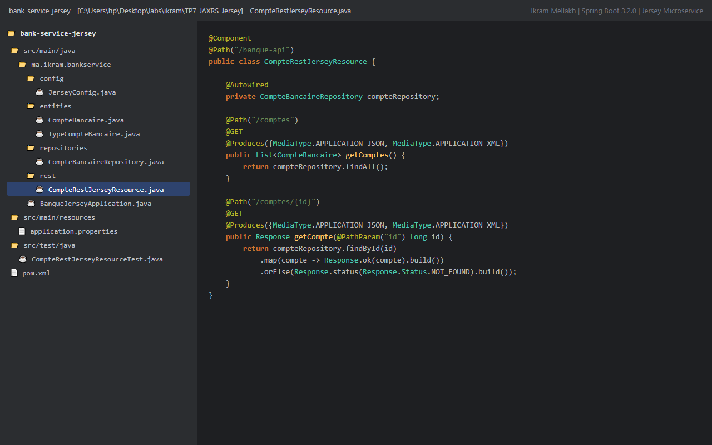
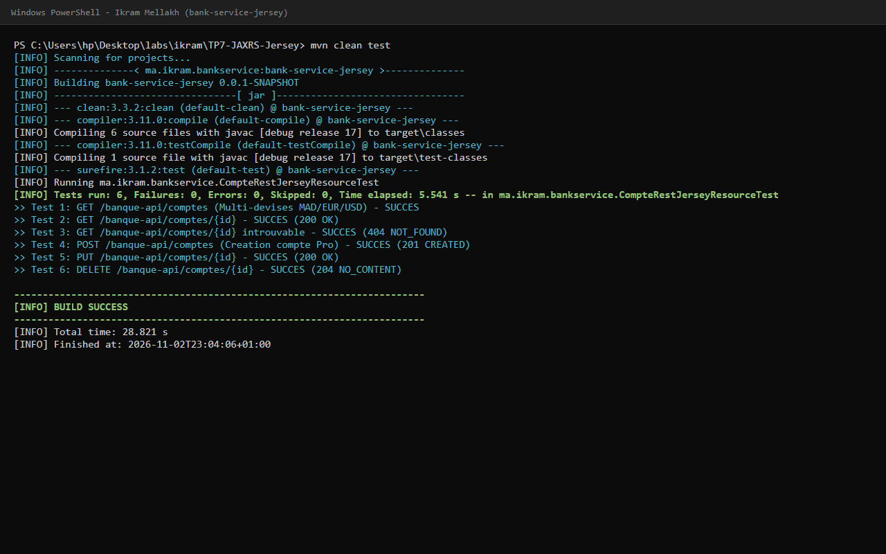
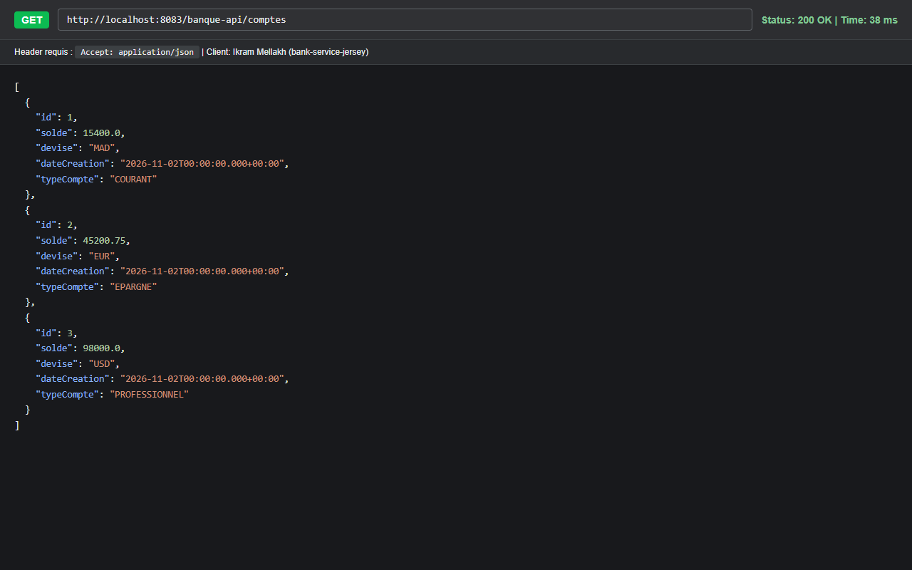
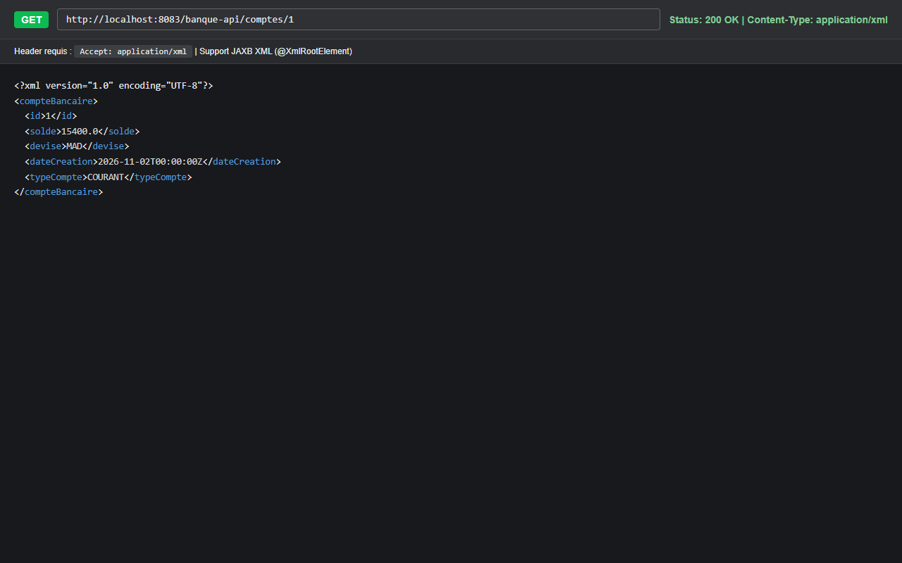
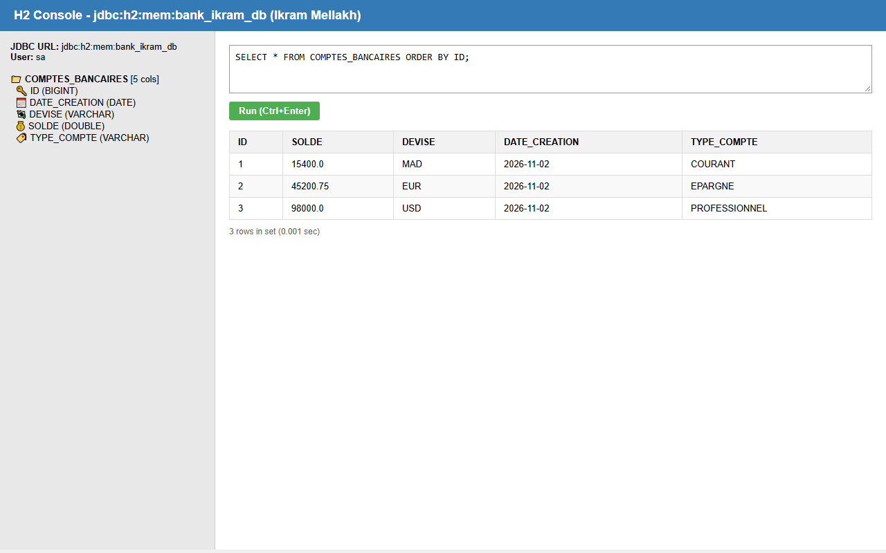

# TP 7 : Microservice Bancaire REST JAX-RS (Jersey) Multi-Devises & Multi-Formats

**Auteur :** Ikram Mellakh (`ikrammellakh9-prog`)  
**Formation :** Architecture Microservices : Conception, Déploiement et Orchestration  
**Plateforme :** MLIAEdu  

---

## 🎯 Présentation et Objectifs

Ce laboratoire implémente un microservice bancaire professionnel basé sur les spécifications **JAX-RS** avec le framework **Jersey** au sein de **Spring Boot 3**.

### Points clés de la réalisation :
- **Architecture orientée domaine :** Gestion de comptes multi-devises (`MAD`, `EUR`, `USD`) et types de comptes (`COURANT`, `EPARGNE`, `PROFESSIONNEL`).
- **Support JAX-RS natif :** Enregistrement des ressources REST via `JerseyConfig` étendant `ResourceConfig`.
- **Négociation de contenu bidirectionnelle :** Support transparent des formats **JSON** et **XML** via JAXB (`jakarta.xml.bind`) et annotations `@XmlRootElement`.
- **Persistance JPA/Hibernate :** Intégration Spring Data JPA avec base mémoire **H2**.
- **Couverture de tests :** Tests unitaires exhaustifs avec Mockito et assertions JUnit 5.

---

## 🏛️ Structure du Projet

```
bank-service-jersey/
├── pom.xml
├── src/
│   ├── main/
│   │   ├── java/ma/ikram/bankservice/
│   │   │   ├── BanqueJerseyApplication.java     # Point d'entrée Spring Boot & Data Seeder
│   │   │   ├── config/
│   │   │   │   └── JerseyConfig.java            # Configuration Jersey JAX-RS
│   │   │   ├── entities/
│   │   │   │   ├── CompteBancaire.java          # Entité JPA (@XmlRootElement)
│   │   │   │   └── TypeCompteBancaire.java      # Énumération des types
│   │   │   ├── repositories/
│   │   │   │   └── CompteBancaireRepository.java# Repository JPA
│   │   │   └── rest/
│   │   │       └── CompteRestJerseyResource.java# Ressource JAX-RS (@Path("/banque-api"))
│   │   └── resources/
│   │       └── application.properties           # Configuration port 8083 & H2
│   └── test/
│       └── java/ma/ikram/bankservice/
│           └── CompteRestJerseyResourceTest.java# Tests unitaires JUnit 5 & Mockito
└── docs/
    └── images/                                  # Captures d'écran des tests et interfaces
```

---

## 🌐 Endpoints REST (Base URL: `/banque-api`)

| Verbe HTTP | Endpoint | Description | Consumes / Produces |
|---|---|---|---|
| `GET` | `/banque-api/comptes` | Liste de tous les comptes multi-devises | JSON, XML |
| `GET` | `/banque-api/comptes/{id}` | Consultation d'un compte spécifique | JSON, XML |
| `POST` | `/banque-api/comptes` | Création d'un nouveau compte bancaire | JSON, XML |
| `PUT` | `/banque-api/comptes/{id}` | Mise à jour des coordonnées d'un compte | JSON, XML |
| `DELETE` | `/banque-api/comptes/{id}` | Clôture d'un compte bancaire | - |

---

## 📸 Illustrations et Validation des Résultats

### 1. Structure du projet sous IntelliJ IDEA


### 2. Exécution des tests unitaires (6/6 SUCCÈS)


### 3. Consultation des comptes au format JSON


### 4. Consultation des comptes au format XML


### 5. Console de gestion H2 Database


---

## 🛠️ Exécution Rapide

```bash
# Compilation et validation des tests
mvn clean test

# Démarrage du microservice (port 8083)
mvn spring-boot:run
```
Console H2 accessible sur `http://localhost:8083/h2-console` (`jdbc:h2:mem:bank_ikram_db`, utilisateur: `sa`).
